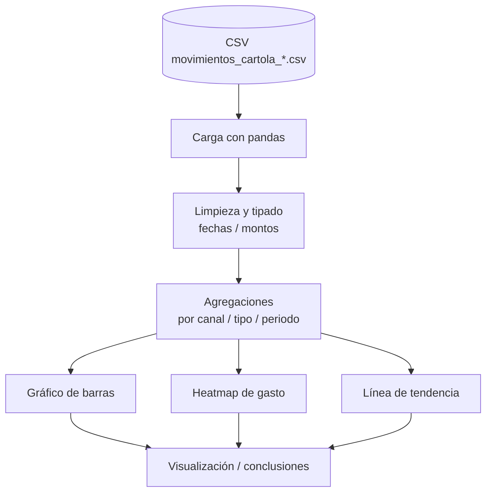

# langraph_financial_agent

Herramienta de exploración y visualización de datos financieros. Realiza EDA sobre movimientos de cartola bancaria (CSV) y genera visualizaciones de patrones de gasto: gráficos de barras, heatmaps y líneas de tendencia.

[](https://github.com/bi0punk/langraph_financial_agent/actions/workflows/ci.yml)
[](https://www.python.org/)
[](LICENSE)

## Contenido

- [Características](#características)
- [Arquitectura](#arquitectura)
- [Stack](#stack)
- [Estructura del repositorio](#estructura-del-repositorio)
- [Instalación](#instalación)
- [Uso](#uso)
- [Configuración](#configuración)
- [Tests / CI](#tests--ci)
- [Datos](#datos)
- [Roadmap](#roadmap)
- [Licencia](#licencia)

## Características

- EDA sobre cartola de movimientos bancarios (CSV).
- Visualizaciones: gráficos de barras, heatmaps, líneas de tendencia.
- Dos notebooks: `app.ipynb` (aplicación) y `EDA_cartola_desde_cero.ipynb` (walkthrough completo).
- Smoke tests que validan la estructura de los notebooks y evitan commitear el CSV personal.

## Arquitectura



El análisis es batch dentro de los notebooks de Jupyter (sin servicio ni API).

## Stack

- **Lenguaje**: Python 3.12+
- **Entorno**: Jupyter Notebook
- **Datos**: pandas, numpy
- **Visualización**: matplotlib
- **Calidad**: ruff (excluye `.ipynb`), pytest

## Estructura del repositorio

```
langraph_financial_agent/
├── app.ipynb                          # Notebook aplicación
├── EDA_cartola_desde_cero.ipynb       # Walkthrough EDA
├── movimientos_cartola_*.csv          # Datos (NO commiteados, ver Datos)
├── requirements.txt
├── pyproject.toml                     # config pytest + ruff
├── tests/test_smoke.py
├── .github/workflows/ci.yml
└── LICENSE
```

## Instalación

```bash
python3 -m venv .venv
source .venv/bin/activate
pip install -r requirements.txt
```

## Uso

```bash
jupyter notebook app.ipynb
```

O abre `EDA_cartola_desde_cero.ipynb` para el walkthrough completo. Los notebooks esperan un CSV de movimientos en la raíz (ver [Datos](#datos)).

## Configuración

No requiere variables de entorno. El único input es el CSV de movimientos en la raíz del proyecto.

## Tests / CI

```bash
pytest -q
```

Smoke tests (`tests/test_smoke.py`): validan la estructura de ambos notebooks (JSON válido, celdas code+markdown), que el CSV de datos personales no esté commiteado y que las deps figuren en `requirements.txt`.

CI — GitHub Actions (`.github/workflows/ci.yml`) sobre Python 3.12:

- `ruff check .` (excluye `.ipynb`).
- `pytest -q`.

El workflow se dispara en push y PR a `main`/`master`.

## Datos

El archivo `movimientos_cartola_2025-12_a_2026-01.csv` contiene **movimientos bancarios personales** y **no se commitea** (excluido vía `.gitignore` con `*.csv`). Coloca tu propio CSV con el esquema:

```csv
fecha,descripcion,canal,monto_clp,tipo,monto_abs_clp
2025-12-25,PAGO EJEMPLO,Débito nacional,-40520,cargo,40520
```

## Roadmap

- [x] EDA sobre cartola en notebooks (`app.ipynb`, `EDA_cartola_desde_cero.ipynb`).
- [x] Visualizaciones (barras, heatmap, tendencia).
- [ ] Análisis como servicio/API (actualmente solo batch en notebook).

## Licencia

MIT — ver [LICENSE](LICENSE).
